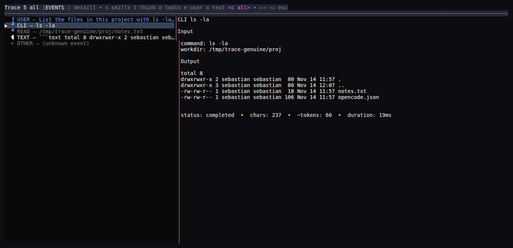
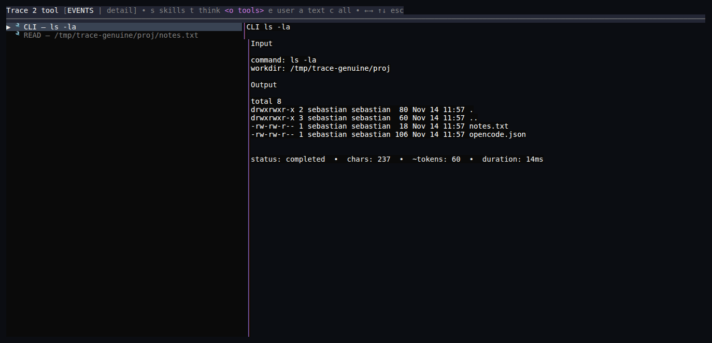
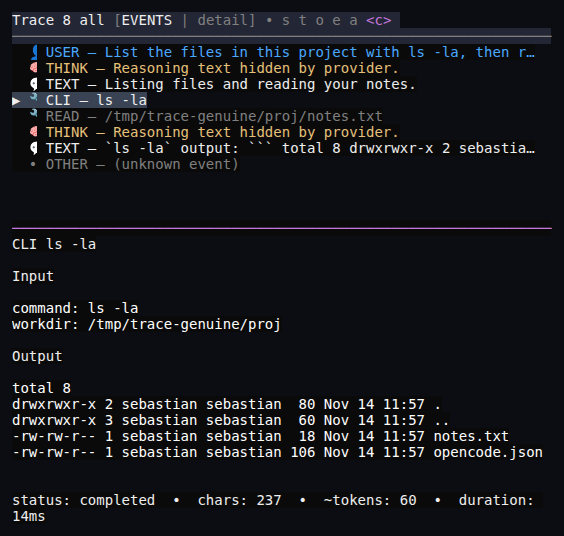

# OpenCode Agent Trace

**See what goes into your agent session.** Explore your agent's context, event by event — prompts, thinking blocks, tool calls, and answers in one live timeline, right inside the TUI. It shows the session events available from the OpenCode server, not a byte-for-byte model request.



Open a session and run `/trace`, or choose **Context Trace: Open Timeline** from the command palette.

## What you get

- **Available events, in order.** User prompts, thinking blocks, tool calls, assistant text, and skills returned for this session — one scrollable timeline, no digging through transcripts.
- **Tool calls fully unpacked.** Structured input and output with real line breaks, plus status, duration, and character and rough token-size estimates per event.
- **One-key filters.** Jump to skills (`s`), thinking (`t`), tools (`o`), user prompts (`e`), or assistant text (`a`); `c` shows everything again.
- **A detail pane worth reading.** Prose renders as markdown (plain-text fallback), tool payloads render as structured text.
- **Always current.** The list refreshes automatically while the panel is open, reading the live session over OpenCode RPC with a local-cache fallback.
- **Built for the terminal.** Theme-aware colors with text and shape markers (never color alone), explicit pane focus, and a stacked layout on narrow terminals.


*Filter to tools to audit a command's input, output, and status.*


*Narrow terminals stack the list above the detail pane.*

| Key | Action |
| --- | --- |
| `←` / `→` (or `h` / `l`) | Focus the event list / detail pane |
| `↑` / `↓` (or `j` / `k`) | Move the selection (list) or scroll (detail) |
| `s` / `t` / `o` / `e` / `a` | Filter events: skills / thinking / tools / user / assistant text; pressing the same key again shows all |
| `c` | Clear the event filter (show all) |
| `PageUp` / `PageDown` | Scroll the detail pane |
| `Esc` | Close the panel |

The header is a frozen top bar with the event count and a compact filter bar. Each row shows an emoji, a badge, and a short preview (for example `🔧 READ — src/index.ts`); the badge appears once and the preview never repeats it. It names the focused pane explicitly as `[EVENTS | detail]` or `[events | DETAIL]`: the active pane appears in uppercase at full strength while the inactive pane is lowercase and muted, so focus never depends on color alone. The divider between the panes is drawn in the theme's active border color on the focused pane's edge. The selected row keeps its highlight background in both panes but shows `▶` at full strength only while the list is focused and a muted `›` when detail is focused, keeping selection visible yet clearly subdued. All colors come from the host theme with plain fallbacks. On narrow terminals (under 80 columns) the list stacks above the detail pane.

## Install locally

Clone this repository, then add its absolute path to the `plugins` array in your OpenCode `opencode.json` or `opencode.jsonc`. Keep any existing entries.

```jsonc
{
  "$schema": "https://opencode.ai/config.json",
  "plugins": ["/absolute/path/to/opencode-agent-trace"]
}
```

This is a local source installation, not an npm release. Do not load another copy of the `context-trace` plugin at the same time. Tested with OpenCode v2.2.7 and v2.3.0; other versions have not been tested.

## Privacy and limits

- This version writes nothing: no captures, no snapshots, no background work, and the plugin itself makes no network calls. Viewing reads whatever the connected OpenCode server already holds for the session via its RPC; if that server is remote, the read travels over that existing connection.
- Files from earlier versions remain under `~/.local/share/opencode/context-trace/` on the server host, including any sensitive content they hold. The plugin never reads, modifies, or deletes them. Protect backups and remove unwanted files manually.
- Secure access to the OpenCode server: session messages can contain prompts, source code, tool outputs, personal information, and secrets.

See [privacy and limitations](docs/privacy-and-limitations.md) for details. If RPC fails, the panel falls back to the locally cached session messages.

## Development

Run `npm test` with Node.js 24 or newer. Licensed under [MIT](LICENSE).
