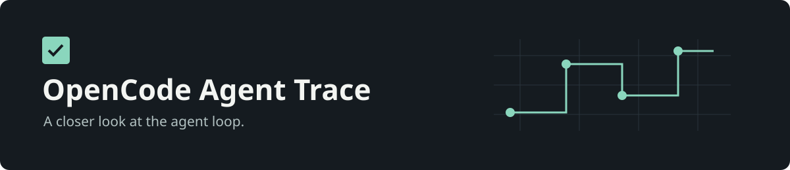
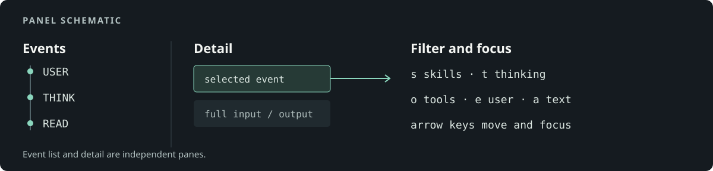

# OpenCode Agent Trace



An experimental OpenCode V2 plugin for inspecting agent-loop events and context snapshots captured by a hook. Browse a terminal timeline, inspect a snapshot, and see what changed since the previous capture.

> **Sensitive data is recorded without redaction.** Snapshots can contain prompts, source code, tool outputs, personal information, and secrets. They persist on the server host even after the plugin or session is removed. Read [privacy and retention](docs/privacy-and-limitations.md) before enabling.

## Install locally

Clone this repository, then add its absolute path to the `plugins` array in your OpenCode `opencode.json` or `opencode.jsonc`. Keep any existing entries.

```jsonc
{
  "$schema": "https://opencode.ai/config.json",
  "plugins": ["/absolute/path/to/opencode-agent-trace"]
}
```

This is a local source installation, not an npm release. Do not load another copy of the `context-trace` plugin at the same time. Tested with OpenCode v2.2.7; other versions have not been tested.

## Explore a session

Open a session and run `/trace`, or choose **Context Trace: Open Timeline** from the command palette.



| Key | Action |
| --- | --- |
| `Tab` | Switch between event and snapshot lists |
| `j` / `k` or arrow keys | Select an item |
| `1` | Inspect the selected event |
| `2` / `3` / `4` | Inspect the selected snapshot's delta / context / system and tools |
| `u` / `d` | Scroll detail |
| `r` / `f` / `q` | Refresh / fullscreen / close |

Event and snapshot selections are independent; the panel does **not** infer an association between them.

## Privacy and limits

- Captures are stored as JSON under `~/.local/share/opencode/context-trace/` on the server host. The plugin requests owner-only permissions, subject to filesystem behavior. Protect backups and remove unwanted files manually; temporary files may remain after a crash.
- No network transmission is implemented by the plugin, but trace data is exposed through OpenCode RPC. Secure access to the OpenCode server.
- The default limit is **1 GiB** across the trace directory. Captures over the limit are skipped, not rotated; existing files are never automatically deleted. Set `maxBytes: 0` to disable capture. See [configuration and operational details](docs/privacy-and-limitations.md).
- A snapshot shows what this plugin's context hook saw, **not necessarily the final model request**. Auxiliary requests are not captured. Capture can fail or be skipped; this is **not an audit log**.
- Snapshot filename order may not reflect causality for simultaneous captures. If RPC fails, the panel falls back to session messages without snapshots.

See [privacy, retention, and limitations](docs/privacy-and-limitations.md) for queue limits, lock recovery, older formats, and failure behavior.

## Development

Run `npm test` with Node.js 24 or newer. Licensed under [MIT](LICENSE).
